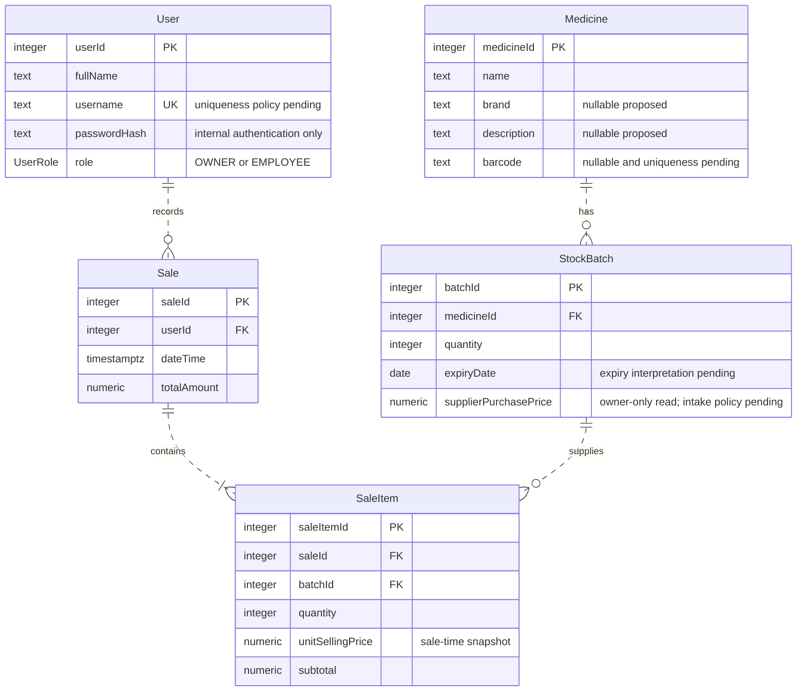

# Pharmacy Management System — Database Design Proposal

Date: 2026-11-13
Status: **Proposal only; awaiting approval before Prisma schema implementation.**

## 1. Scope, sources, and evidence labels

This proposal investigates User, Medicine, StockBatch, Sale, and SaleItem. It does not authorize application features, migrations, database changes, or decisions on behalf of the pharmacy owner.

Reviewed sources:

- Full local requirements analysis, especially the requirement inventory, UML, and unresolved decisions. The public repository includes an [anonymized requirements summary](public-requirements.md).
- **A1:** Assignment-1 Report, 31 pages, preserved locally as `docs/requirements/assignment-1-repor.pdf`.
- **A2:** Assignment-2 Report, 26 pages, preserved locally as `docs/requirements/assignment-2-instructions.pdf`. Its actual content is a design/testing report despite its filename.
- [Project rules](../AGENTS.md), the current [workspace configuration](../package.json), [API dependencies](../apps/api/package.json), [Prisma configuration](../apps/api/prisma/schema.prisma), and [PostgreSQL development configuration](../infrastructure/docker/compose.yaml).

PDF references use physical page numbers, counting the cover as page 1. The project currently has Next.js and NestJS workspaces, a shared package, PostgreSQL 17 development configuration, and Prisma 6.12.0. Its Prisma schema contains connection/generator configuration and no domain models.

Publication note: the original reports and full analysis remain local and are not
included in the public repository because they contain identifiable private context.
This dated proposal is historical; see [MVP decisions](mvp-decisions.md) for the
subsequently authorized implementation.

The categories used throughout are:

- **Assignment requirement/design:** explicitly stated prose, numbered requirements, or UML attributes/relationships. UML evidence is identified where relevant; an attribute in UML does not by itself establish whether a form field is mandatory.
- **Technical recommendation:** a proposed implementation choice for review, not a new assignment requirement.
- **Owner confirmation needed:** an unresolved business rule. No answer is assumed.

Only this proposal is added to the project. Existing requirements, application code, Prisma configuration, and project rules remain unchanged.

## 2. What the assignments establish

| Original requirement or source | Database-relevant evidence |
|---|---|
| FR-01 — Add Medicine | Authorized employees can add medicines. A2 p. 22 and TC03–TC04 require valid information and rejection of missing required information, without enumerating every required field. |
| FR-02 — Update Stock | Authorized employees can update quantities. A2 p. 22 and TC05–TC06 add batch information and quantity validation. |
| FR-03 — Track Expiry Dates | Store expiry dates for each medicine. A1 pp. 18–19 and A2 p. 3 refine the design to expiry dates on StockBatch. Confirm that granularity with the owner. |
| FR-04 — Update Selling Price | Authorized employees can enter/change selling prices. The class diagram omits a current selling-price field, so its storage location remains open. |
| FR-05 — View Supplier Price; NFR-02 — Price Privacy; SR-07 — Access control | Original supplier purchase prices must be visible only to the owner, enforced in the backend. |
| FR-06 — Generate Reports | Owner can view stock and expiry reports. Employee report access and sales/profit report scope remain inconsistent or incomplete. |
| NFR-01 — Security; SR-06 — Authentication | Protected features require login. A2 specifies username/password authentication behavior. |
| NFR-04 — Performance | Medicine search results should appear within 2 seconds under normal conditions; search matching and load are unspecified. |
| NFR-05 — Reliability | Save valid changes correctly and report saving failures. |
| SR-05 — Database | PostgreSQL and Prisma ORM. |
| SR-09 — Data protection; SR-10 — Testing | Backups with tested recovery, and testability of the main functions. These do not prescribe extra domain tables. |
| A1 class diagram/prose, pp. 18–19; A2 pp. 2–5 | The five entities, their original attributes, and the main relationships below. |
| A1 p. 19 | SaleItem records quantity, selling price **at the time of sale**, and subtotal; Sale records date/time and total amount. |
| A1 pp. 18, 24–25; A2 pp. 22–25, TC07–TC09 | Check stock and expiry before completing a sale; reject insufficient or expired stock; valid sales update stock. Both owner and employees can record sales in A1 p. 25. |

**Record Sale is explicit unnumbered assignment behavior, not UML-only functionality.** It has no entry in FR-01–FR-06. This proposal preserves those original IDs rather than inventing FR-07.

A2 separates authentication, expiry checking, sale orchestration, and repositories into services/interfaces. **AuthenticationService, ExpiryChecker, DefaultExpiryChecker, SaleService, StockBatchRepository, and PrismaStockBatchRepository are not database entities merely because they appear in the class design.** The same applies to report factories, proxies, facades, and observers.

## 3. Relationships, cardinalities, and keys

The written relationships in A1 p. 19, retained by A2 pp. 2–5, support this interpretation:

| Relationship | Parent can have | Each child belongs to | Proposed foreign key |
|---|---|---|---|
| User records Sale | Zero or many sales | Exactly one recording User | Sale.userId → User.userId |
| Medicine has StockBatch | Zero or many batches | Exactly one Medicine | StockBatch.medicineId → Medicine.medicineId |
| Sale contains SaleItem | One or many items for a completed sale | Exactly one Sale | SaleItem.saleId → Sale.saleId |
| StockBatch supplies SaleItem | Zero or many sale items over time | Exactly one StockBatch | SaleItem.batchId → StockBatch.batchId |

The zero lower bounds let users/medicines/batches exist before their first sale or stock entry. These are technical interpretations consistent with the UML's `0..*` labels. The minimum of one SaleItem comes directly from A1's prose and UML.

**UML inconsistency to confirm:** In the class-diagram image, the connector labeled `records` visually reaches Medicine from User, with another Medicine–Sale connector. The prose expressly says one User records multiple Sale records. The proposed ER model follows that prose; it does not invent a separate User–Medicine ownership relationship or direct Medicine–Sale foreign key.

### Proposed key strategy — technical recommendation

- Retain the original primary-key names: userId, medicineId, batchId, saleId, saleItemId.
- Use database-generated PostgreSQL `integer` surrogate keys, matching the UML's `int` identifiers. A surrogate key identifies a row independently of editable business information. Choose the Prisma-compatible sequence/identity generation detail during implementation; IDs need not be gap-free.
- All proposed foreign keys use the same `integer` type as their referenced key and are required under the relationship interpretation above.
- Do not use usernames, barcodes, or dates as primary keys. No evidence requires UUIDs, distributed ID generation, or offline synchronization.
- Keep the logical entity names intact. Physical SQL names such as `app_user`, `medicine`, `stock_batch`, `sale`, and `sale_item` are a naming recommendation; `app_user` avoids ambiguity with SQL's special `USER` name. Confirm naming before implementation.

SaleItem connects sales to stock batches. Medicine is reached through SaleItem → StockBatch → Medicine, avoiding a duplicate SaleItem.medicineId that could disagree with its batch. This depends on protecting the batch's medicine association after sales reference it.

## 4. Proposed fields and PostgreSQL types

**Nullability is proposed, not approved.** “Required” below means a recommended `NOT NULL` field in a valid stored record. The assignments list attributes but do not specify SQL nullability. “Optional” means a recommended nullable field, subject to owner confirmation. Blank strings should not substitute for meaningful required input, and missing prices must never be silently converted to zero.

### 4.1 User

| Field | Source | Proposed type | Proposed presence | Notes |
|---|---|---|---|---|
| userId | A1 UML; A2 p. 3 | integer | Required, PK | Database-generated. |
| fullName | A1 UML; A2 p. 3 | text | Required, recommendation | Confirm display-name requirements. No arbitrary maximum length is invented here. |
| username | A1 UML; A2 p. 3 and login tests | text | Required | Unique login identifier recommended; case/normalization policy remains open. |
| passwordHash | A1 UML; A2 p. 3 | text | Required for password-based accounts | Store a password hash, never plaintext. Hash algorithm and account provisioning are separate implementation decisions. |
| role | A1 UML/profile; A2 p. 17 | UserRole enum | Required | OWNER and EMPLOYEE only; no automatic OWNER default. An enum is a proposed PostgreSQL implementation of the documented roles. |

Do not duplicate the role into separate Owner/Employee tables or store canViewPurchasePrice as an independently editable flag. That permission follows the role and must not drift out of agreement with it. No uniqueness constraint limiting the system to one OWNER is justified by the documents; confirm ownership/account policy first.

### 4.2 Medicine

| Field | Source | Proposed type | Proposed presence | Notes |
|---|---|---|---|---|
| medicineId | A1 UML | integer | Required, PK | Database-generated. |
| name | A1 UML; A2 p. 22 | text | Required, recommendation | Defines the displayed medicine name; product/strength/pack identity still needs clarification. |
| brand | A1 UML; A2 p. 22 | text | Optional, recommendation | Requiredness must be confirmed; generic/unbranded entry rules are not specified. |
| description | A1 UML; A2 p. 22 | text | Optional, recommendation | No minimum description content is established. |
| barcode | A1 UML; A2 p. 22 | text | Optional, recommendation | Preserve leading zeros and formatting; not an integer. Whether every medicine has a unique barcode is unresolved. |

FR-04 also needs a place for the **current** selling price. The following are alternatives, not two approved fields:

| Candidate | When it fits | Presence if selected |
|---|---|---|
| Medicine.currentSellingPrice | One current selling price for every batch of the same medicine/product. A1 p. 28's illustrative updateSellingPrice(medicineId, price) points in this direction but does not settle policy. | Proposed numeric(18,4); whether it must exist at medicine creation needs confirmation. |
| StockBatch.currentSellingPrice | Different batches of the same medicine can carry different current selling prices. | Proposed numeric(18,4); intake/price-entry timing needs confirmation. |

These candidate names are technical additions, not original UML attributes. **Do not choose a location, implement both, or use an invented zero-price default before owner confirmation.** The ER diagram omits the unresolved current-price field explicitly; it is not a complete implementation schema for FR-04.

### 4.3 StockBatch

| Field | Source | Proposed type | Proposed presence | Notes |
|---|---|---|---|---|
| batchId | A1 UML | integer | Required, PK | Database-generated internal batch record ID; not a manufacturer lot number. |
| medicineId | Relationship-derived technical field | integer | Required, FK | References Medicine.medicineId. |
| quantity | A1 UML; FR-02; A2 p. 22 | integer | Required | Recommend zero or greater for current on-hand stock. Unit/pack rules must be confirmed. |
| expiryDate | A1 UML; FR-03; A2 p. 3 | date | Required for a complete batch, recommendation | Fits a calendar-day expiry. Month-only printed expiry requires a confirmed interpretation before storage. |
| supplierPurchasePrice | A1 UML/prose; A2 p. 3 | numeric(18,4), provisional | Required for a complete cost-bearing batch, recommendation | Owner-only read access. Whether an employee can create a batch before the owner supplies the cost remains unresolved. |

The purchase-price nullability and batch-intake workflow are a **schema approval blocker**. A nullable cost could represent an incomplete intake only if that workflow is approved; it must not be introduced as a shortcut around missing requirements. This proposal does not assume that missing cost is zero or decide whether such a batch can be sold.

Do not store another authoritative quantity on Medicine. Derive on-hand stock from its batches. Distinguish total on-hand stock from saleable stock: expired quantities may remain physically present but cannot be sold. The precise saleable-date predicate depends on the confirmed expiry policy.

### 4.4 Sale

| Field | Source | Proposed type | Proposed presence | Notes |
|---|---|---|---|---|
| saleId | A1 UML | integer | Required, PK | Database-generated; not automatically a legal receipt/invoice number. |
| userId | Relationship-derived technical field | integer | Required, FK | Recording user, derived from authenticated backend context rather than trusting a submitted userId. |
| dateTime | A1 UML/prose | timestamp with time zone (3) | Required | Recommend a backend-assigned sale instant. Backdating/correction policy is not specified. |
| totalAmount | A1 UML/prose | numeric(18,4), provisional | Required for a completed sale | Computed by the backend from agreed pricing rules, not accepted as authoritative client input. |

No draft, pending, cancelled, or refunded status is added: those workflows are not defined. The proposed baseline represents completed sales committed together with their items and stock deductions; confirm that baseline with the owner.

### 4.5 SaleItem

| Field | Source | Proposed type | Proposed presence | Notes |
|---|---|---|---|---|
| saleItemId | A1 UML | integer | Required, PK | Database-generated. |
| saleId | Relationship-derived technical field | integer | Required, FK | References Sale.saleId. |
| batchId | Relationship-derived technical field | integer | Required, FK | References the actual StockBatch used for this item. |
| quantity | A1 UML/prose | integer | Required | Recommend a strictly positive sold quantity; whole-unit suitability needs confirmation. |
| unitSellingPrice | A1 UML/prose | numeric(18,4), provisional | Required | Immutable selling-price snapshot for this sale item. |
| subtotal | A1 UML/prose | numeric(18,4), provisional | Required | Store the backend-calculated line result, preserving the modeled attribute. |

No extra createdAt/updatedAt, email, phone, customer, payment, or receipt fields are declared mandatory merely by convention. Such additions would need a stated purpose and scope decision.

## 5. Financial precision, dates, and consistency

### Money — technical recommendation, pending business policy

Use exact decimal storage instead of floating-point types. PostgreSQL `numeric(p,s)` provides controlled precision/scale; values with excess fractional digits can be rounded on storage, so the backend must apply the agreed policy first. See [PostgreSQL numeric types](https://www.postgresql.org/docs/17/datatype-numeric.html).

`numeric(18,4)` is a **candidate**, allowing fourteen integer digits and four fractional digits. Four stored decimal places do not mean prices must be displayed with four decimals or that the pharmacy uses any particular currency. The assignments provide no currency, rounding, maximum amount, discount, or tax policy.

Use decimal arithmetic for calculations, not JavaScript floating-point arithmetic. Reject non-finite monetary input and define compatible database protection; a simple nonnegative comparison alone is not a complete validation rule. Reject out-of-range amounts before commit, including multiplication/sum overflow. Do not silently round excessive precision to make input fit.

If the owner confirms simple per-unit pricing without adjustments, a candidate formula is quantity × unitSellingPrice for each subtotal and the sum of subtotals for totalAmount. That formula and rounding stage are **not assumed requirements**. Stored totals and line values must be generated together under the final agreed rules; later price changes must not recalculate old sales.

Currency and scale must be confirmed before finalizing numeric constraints. If multiple currencies are actually required, their representation needs an explicit design decision; do not mix unlabelled currencies or invent a currency table now.

### Dates — technical recommendation

Use a calendar `date` for day-based expiry and `timestamptz(3)` for the Sale.dateTime instant. PostgreSQL stores a timestamptz instant independently of a display timezone; it does not retain the originally supplied zone name. See [PostgreSQL date/time types](https://www.postgresql.org/docs/17/datatype-datetime.html).

Confirm the pharmacy's business timezone, end-of-day/month interpretation, and whether sale is allowed on the printed expiry date. Do not convert month-only expiry into an invented first/last day. Do not assume the development computer's timezone is the pharmacy's policy. Alerts and sale validation must use the same approved rules.

## 6. Constraints, indexes, and historical integrity

### Proposed constraints

| Constraint | Classification | Purpose / limitation |
|---|---|---|
| PK on each original ID; required FKs in section 3 | Technical recommendation based on UML | Prevent ambiguous identity and orphan child rows. |
| Unique username | Technical recommendation | Avoid ambiguous login. Confirm whether case-sensitive, case-insensitive, and/or normalized before selecting the actual uniqueness mechanism. |
| Unique non-null barcode | Conditional recommendation | Appropriate only if a barcode identifies exactly one Medicine record. Until confirmed, do not make this an approved constraint. |
| StockBatch.quantity ≥ 0 | Technical recommendation supporting FR-02 and sale rules | Prevent negative on-hand stock, including through non-sale writes. Zero permits a sold-out batch to remain in history. |
| SaleItem.quantity > 0 | Technical recommendation supporting valid sales | Negative sale quantities must not implicitly implement returns. Confirm the sale unit first. |
| Finite monetary values with agreed sign/range rules | Technical recommendation; policy pending | Confirm zero-price/cost handling and rounding; do not impose a purchase-price ≤ selling-price rule. |
| Protect referenced history from deletion | Technical recommendation; deletion policy pending | Recommend restrictive foreign-key delete behavior instead of cascading medicine/batch/user deletion into sales. |

Do **not** make medicine names unique, or impose uniqueness on (medicineId, expiryDate), (medicineId, expiryDate, supplierPurchasePrice), or (saleId, batchId) without a business rule. Repeated deliveries and repeated sale lines may be valid. Nullable barcode uniqueness must account for PostgreSQL's default treatment of NULL values as distinct. Primary/unique constraints already create their own indexes, whereas FKs do not automatically index the referencing columns. See [PostgreSQL constraints](https://www.postgresql.org/docs/17/ddl-constraints.html).

### Candidate indexes — technical recommendations, to validate with actual queries

| Table / columns | Purpose |
|---|---|
| StockBatch(medicineId, expiryDate, batchId) | Retrieve a medicine's batches with expiry information; leading medicineId also supports the FK lookup. Does not choose an allocation policy. |
| StockBatch(expiryDate) | Global expiry-report/alert date-range queries; the medicine-leading index is not a substitute for every global date query. |
| Sale(userId, dateTime) | Retrieve records associated with a user and support the user FK lookup. Does not authorize additional sales-report features. |
| SaleItem(saleId) | Load a sale's items and support the sale FK lookup. |
| SaleItem(batchId) | Trace which sale items used a batch and support the batch FK lookup. |

Add a standalone Sale.dateTime index only if approved queries need it. Medicine-name search indexes must follow confirmed search behavior: an ordinary name index is not a general solution for case-insensitive substring search. Consider specialized indexing only when justified by NFR-04 measurements and real query plans. Avoid duplicate FK indexes already covered by a useful leading column. See [PostgreSQL multicolumn indexes](https://www.postgresql.org/docs/17/indexes-multicolumn.html).

### Rules not guaranteed by ordinary row constraints

The service/transaction must ensure that each committed Sale has at least one SaleItem, totals match the approved calculation, and sales use non-expired stock. Ordinary FKs do not ensure a parent has a child, and row CHECK constraints are not suitable for cross-table aggregates or a condition that changes merely as time passes. Do not reject storage of an already-expired batch: expiry reports still need to see it. See [PostgreSQL constraint limitations](https://www.postgresql.org/docs/17/ddl-constraints.html#DDL-CONSTRAINTS-CHECK-CONSTRAINTS).

Recommend preventing ordinary reassignment of a used batch to another Medicine and preventing ordinary editing of completed-sale price snapshots. Whether historical corrections, archiving, or deletions are permitted must be confirmed. Application methods such as isExpired(), calculateTotal(), and hasPermission() do not become stored columns just because they appear in UML.

## 7. Multiple batches for the same medicine

**Assignment design:** A1 pp. 18–19 and A2 pp. 3–5 place quantity, expiryDate, and supplierPurchasePrice on StockBatch, with multiple batches linked to one Medicine.

**Illustration only — invented test data, no currency or actual pharmacy prices implied:**

| Medicine | Batch | quantity | expiryDate | supplierPurchasePrice |
|---|---|---|---|---|
| medicineId 10 | batchId 101 | 20 | 2027-06-30 | 1000.0000 |
| medicineId 10 | batchId 102 | 15 | 2027-12-31 | 1100.0000 |

Both rows point to the same medicineId, while retaining independent expiry and cost. An employee-facing response may include the quantities and dates, but **must omit the supplierPurchasePrice column**. Do not merge these rows into one medicine-level expiry or cost value.

The documents do not define whether “batch” means a manufacturer's physical lot or a received inventory/cost group. Recommend allowing distinct internal batch records for distinct acquisition prices, even if expiry dates match. Confirm repeated receipts, cost-per-pack versus cost-per-sold-unit, and whether printed lot tracking is required before introducing lot numbers or receipt tables. No batch-merging algorithm is selected here.

## 8. Preserving sale-time prices

**Assignment design:** SaleItem.unitSellingPrice is explicitly the selling price at the time of sale (A1 p. 19).

**Technical recommendation:** At sale confirmation, the backend resolves the agreed selling-price source and stores its value on each SaleItem. Existing items continue to use this snapshot when the current medicine/batch price changes. Old totals use their recorded line results rather than joining to today's selling price.

For example, a sale item recorded at 1500.0000 remains at that price after a later current-price update to 1700.0000. These figures are illustrative only. The choice of current-price source remains open; permission to edit selling prices does not automatically define permission to override a price within a sale.

SaleItem references its StockBatch for batch traceability. If historical cost/profit reporting is approved, confirm whether batch purchase costs are immutable or whether historical cost snapshots/corrections are needed. Do not add cost to employee-visible sale items or infer an unapproved profit-calculation workflow.

## 9. Safely updating quantities during sales

**Assignment requirements:** Reject insufficient or expired stock and update quantities on valid sales (A2 pp. 22–25, TC07–TC09). **Technical recommendation:** Save the sale, all its items, and all stock deductions in one database transaction so they commit or roll back together. See [PostgreSQL transactions](https://www.postgresql.org/docs/17/tutorial-transactions.html).

Proposed transaction flow, not application code:

1. The backend authenticates/authorizes the actor and validates item structure and quantities. Resolve the batch selections under the owner's approved allocation rule; no automatic FEFO/FIFO policy is invented here.
2. Group requested quantities per batch for validation, even if the sale contains repeated lines referencing that batch.
3. Within a short transaction, acquire row locks for all affected batches in a consistent batchId order. Protect any separate current-price source as needed so its accepted value and the sale snapshot agree. All stock-writing paths must follow a compatible concurrency protocol.
4. Re-read authoritative quantities, batch ownership, and expiry information after any lock wait. Apply the confirmed expiry/timezone rule using an appropriate current validation instant, not a stale UI result. Validate the sale-time price under the confirmed policy.
5. Reject the whole operation if any selected batch lacks sufficient valid stock. Otherwise deduct quantities with an atomic guarded update and verify the expected affected-row count. A preliminary read followed by an unconditional write of an old absolute quantity is unsafe.
6. Store Sale and its nonempty SaleItem set, price snapshots, and calculated amounts in the same transaction. If any deduction or insert fails, roll everything back; no partial sale or partial stock deduction is accepted.
7. Return confirmation only after commit. Keep network calls and user interaction outside the locked transaction.

For example, if 5 units remain and two employees each request 4, the first valid transaction can leave 1 unit; the other must see the updated state and reject. Both must not succeed. PostgreSQL row locks coordinate competing updates; a consistent lock order reduces deadlocks. See [PostgreSQL explicit locking](https://www.postgresql.org/docs/17/explicit-locking.html).

This is a proposed row-locking approach; a transaction alone does not make a naive read-modify-write safe. Serializable isolation is an alternative requiring retry handling. Use bounded handling of deadlocks/serialization failures and retry the whole transaction only when safe. A request with an uncertain commit outcome must not simply be replayed as a new sale; define duplicate-submission/idempotency behavior before implementing retry after network failure. See [PostgreSQL transaction isolation](https://www.postgresql.org/docs/17/transaction-iso.html).

Manual stock adjustments must not bypass the same protections or overwrite quantities changed by sales. Operation semantics, adjustment reasons, and whether an inventory ledger is required need owner confirmation. Concurrency protection does not settle those business rules.

A2's layers remain intact: SaleService coordinates the use case, ExpiryChecker supplies the agreed policy, and the technical repository layer performs persistence using a shared transaction context. Repository calls must not accidentally use separate independent connections/transactions for the same sale. Confirm Prisma 6.12.0 implementation details during the approved schema/application work; no schema or executable transaction is introduced here.

## 10. Owner/employee permissions and sensitive data

**Explicit requirements:** FR-05, NFR-02, SR-07, A1 pp. 23–25 and 28, and A2 TC11–TC12 protect original supplier purchase prices. A1 p. 28 explicitly explains why hiding the UI field alone is insufficient.

| Data / operation | Owner | Employee | Proposal implication |
|---|---|---|---|
| Medicine details, permitted stock information, expiry alerts | Available under documented permissions | Available under documented permissions | Return only fields needed for the authorized operation. |
| Current selling price | May view/manage in the design | May enter/change when authorized, FR-04 | This does not grant purchase-cost access. |
| StockBatch.supplierPurchasePrice | May view | Must never view | Dedicated owner-authorized access; exclude the field from employee queries/responses and exports. |
| Supplier-price entry/correction | Not fully specified | Not fully specified | Confirm write permissions; owner-only read access does not answer who records the value. |
| User.passwordHash | Not returned as profile data | Not returned as profile data | Internal authentication data only, including for the owner's own profile. |
| Stock/expiry/sales/profit reports | Owner stock/expiry access explicit | Report access disputed in UML | Confirm scope and filter sensitive fields before granting employee reports. |

Technical recommendations:

- Both clients access the backend, not PostgreSQL directly. A role value in User does not by itself enforce column secrecy in the database or API.
- Use explicit query/response field allowlists, including nested relations. Avoid fetching full batch objects into employee-facing workflows and relying on later UI hiding.
- Check authenticated backend role before reading/returning purchase costs. Do not trust role or userId values supplied by a client.
- Check reports, totals derived from costs, logs, error messages, and exports for indirect disclosure. Report permissions remain an open decision.
- Keep database credentials outside source control. Separate privileged cost-access methods from ordinary inventory methods, in line with A2's interfaces and Proxy intent.

A separate private-cost table is not automatically required to implement the documented backend access boundary. It could be considered if stronger database-level separation is approved, but it is not silently added to the five-entity design. The owner and employee application accounts are not assumed to be separate PostgreSQL login roles.

## 11. Are additional tables necessary?

**No additional table is unconditionally necessary to express the currently defined five-entity relationships and core stock/sale/privacy behavior.** This is a technical assessment, not a conclusion that all missing workflows have been settled.

| Candidate | Existing evidence | Proposal |
|---|---|---|
| Supplier | Explicit stakeholder need for supplied products/orders in A1 p. 7, and database scope mentions suppliers on p. 14; no fields/workflow or UML entity is supplied. | Genuine scope question. If the owner confirms identified supplier records, a Supplier table with a batch/supply relationship will be needed. Do not invent its columns, purchasing workflow, or per-batch supplier cardinality now. |
| Role / Permission / user-role join tables | Two fixed roles are modeled; no configurable permission administration or multi-role users is specified. | Not needed for the proposed two-value UserRole enum. Revisit only if actual permission requirements demand it. |
| StockMovement / StockAdjustment ledger | Quantity updates and sales are required; a complete inventory history/reconciliation workflow is not specified. | Valuable possible safeguard, but not established as mandatory. Ask whether stock change reasons/history are required before adding a ledger. |
| ExpiryAlert | Alert visibility is explicit; acknowledgement, delivery history, and persistence are not. | Expiry/near-expiry queries can derive alerts from StockBatch after the threshold is confirmed. No persistent alert table is currently justified. |
| Report | Stock/expiry reports are required; saved report records are not. | Query existing data; no report table needed solely to display reports. |
| PriceHistory | Current selling-price edits and sale-time price preservation are required. | SaleItem snapshots preserve sale prices without a separate history table. Add price-edit history only if a separate audit need is confirmed. |
| SaleItemBatch allocation | Current UML links each SaleItem to one StockBatch. | The five-table model can represent a sale using several batches as separate batch-specific items, if that presentation is approved. A separate allocation table is conditional on a requirement for one logical line spanning multiple batches. |
| Session / password-reset tables | Authentication is required; session/recovery design is not chosen. | Conditional on the later approved authentication method, not mandated by the class model or this database proposal. |
| Customer / Order / Payment | Customers are stakeholders, not portal users. Online ordering, customer accounts, and payment features are excluded. | Do not add these tables/features. |

## 12. Proposed ER diagram

This Mermaid diagram depicts the five-entity proposal, not an approved Prisma schema. It follows the written User–Sale relationship despite the connector ambiguity in the original image. Every child FK shown is proposed as required. Medicine brand/description/barcode are proposed nullable; purchase-cost intake nullability is unresolved. Numeric precision and the current selling-price location remain subject to confirmation.

`||` means exactly one, `o{` zero or many, and `|{` one or many. Dashed relationships indicate that child rows have their own surrogate primary keys rather than using the parent key as part of their primary key. The Sale–SaleItem minimum is a committed-sale rule to enforce in the write path; the diagram does not imply that an FK alone enforces it.

The diagram intentionally does **not** invent a Medicine.sellingPrice or StockBatch.sellingPrice field, Supplier relationship, customer relationship, or batch-allocation policy. Resolve the stated gaps before converting it into a final schema.

## 13. Questions requiring pharmacy-owner confirmation

These are questions, not assumed answers. Questions affecting fields/nullability must be settled before those parts of the schema are implemented.

| Priority / topic | Confirmation needed |
|---|---|
| Schema blocker — medicine identity | Does one Medicine represent a particular strength, dosage form, and pack/unit? Which of name, brand, description, and barcode are mandatory? Can records share barcodes? |
| Schema blocker — current selling price | Is there one current selling price per Medicine or per StockBatch? When must it first be entered? Can employees override a price within a sale? |
| Schema blocker — purchase-price intake | Who enters and corrects supplierPurchasePrice? Can an employee add quantity/expiry information without entering or seeing cost? Are incomplete cost records allowed? |
| Schema blocker — units | Are stock/sales quantities whole packs, individual units, or divisible amounts? Is the supplier purchase price per received pack or per sold unit? |
| Schema blocker — money | Which currency/currencies are required? What input precision, rounding stage, zero-price rules, and maximum amounts apply? Are any pricing adjustments actually required? No payment workflow is proposed. |
| Schema blocker — expiry representation | Is printed expiry a full day or month/year? Is expiry per batch as modeled? Confirm timezone and the sale cutoff, including the printed expiry day. |
| Schema blocker — batch identity and allocation | Does a batch mean physical lot or receipt/cost group? How are repeated deliveries handled? How are batches chosen for a sale, and may a single logical item span several batches? |
| Scope blocker — Supplier | Must named suppliers and supplied orders be recorded in the first release? If so, what information and relationships are actually needed? |
| Model clarification | Confirm the proposed User–Sale relationship and the absence of a direct User–Medicine ownership link. Confirm Record Sale's implementation baseline despite its missing FR-table entry. |
| Access/report scope | Which reports may employees access? Are sales/profit reports required, and what information must remain private? |
| Lifecycle/history | May medicines, users, batches, or completed sales be deleted/corrected? Are account deactivation and archived records needed? Are stock/price change reasons and history required? |
| Accounts | How are users created and roles assigned? Is more than one owner account allowed? Must usernames ignore case? No administrator role is assumed. |
| Alert policy | How many days count as near expiry? Is displaying alerts sufficient, or is acknowledgement/delivery history required? |
| Sale reliability | Must the system detect duplicate submissions or uncertain retries? Are there any draft/cancellation/correction workflows? None has been invented. |
| Data import and recovery | What handwritten data will be entered initially? How are unknown expiry/cost values handled? Confirm backup ownership, frequency, retention, and recovery targets required by SR-09. |

These questions can be answered in small groups, starting with medicine/unit identity, current selling-price location, supplier-price intake, money, and expiry. Approval of a drawing alone should not be treated as answers to every unresolved policy.

## 14. Verification and approval boundary

This is a document-only change. Verification covers source traceability, field/relationship consistency, relative file links, the Mermaid block's entity/edge structure, and preservation of existing project files. No live database behavior, transaction safety, migration, Prisma model, or rendered Mermaid image is claimed as tested.

After schema approval, implementation should verify the original A2 cases relevant to the database, including TC03–TC12, and add technical tests for foreign-key integrity, missing/duplicate identifiers, price-snapshot preservation, insufficient/expired stock rejection, concurrent sales, repeated batch lines, and transaction rollback. Boundary tests must use the approved currency, quantity, and expiry rules. These are proposed future checks, not executed tests or new original requirement IDs.

**Next action:** Review the proposed technical choices and answer the schema-blocking business questions. Wait for explicit approval before editing [schema.prisma](../apps/api/prisma/schema.prisma), creating migrations, or changing application code.
