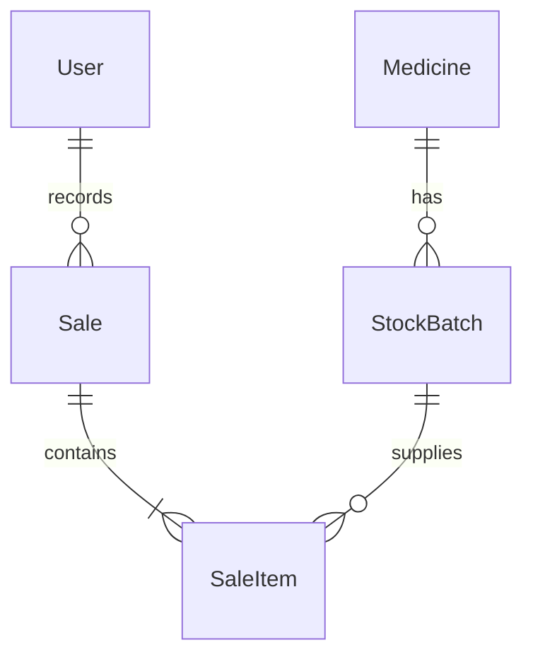

# PharmaDesk requirements summary

This anonymized summary preserves the requirement IDs and terminology from SE421
Assignments 1 (A1) and 2 (A2). It separates assignment requirements from the current
demonstration implementation. The original assignment documents and full analysis
are preserved locally and excluded from the public repository for privacy.

## Functional requirements

These are all six original numbered functional requirements from A1.

| Original ID | Original requirement name | Stated behavior |
|---|---|---|
| FR-01 | Add Medicine | Allow authorized employees to add new medicines. |
| FR-02 | Update Stock | Allow authorized employees to update medicine quantities. |
| FR-03 | Track Expiry Dates | Store the expiry date of each medicine; the detailed design stores it per StockBatch. |
| FR-04 | Update Selling Price | Allow authorized employees to enter and change selling prices. |
| FR-05 | View Supplier Price | Allow only the owner to view the original supplier price. |
| FR-06 | Generate Reports | Allow the owner to view stock and expiry reports. |

**Record Sale is explicitly required in assignment prose and supported by UML and
TC07–TC09; it is not UML-only.** It has no original FR ID. Both roles can record
sales; valid sales save details and reduce stock. Expired or insufficient-stock
sales must be rejected. No invented FR-07 is assigned.

Login, stock visibility, and expiry alerts also have explicit unnumbered support.
Medicine deletion appears in UML without a defined workflow or deletion policy;
it is not part of the implemented MVP.

## Non-functional requirements

| Original ID | Original requirement name | Stated quality constraint |
|---|---|---|
| NFR-01 | Security | Require login before accessing protected features. |
| NFR-02 | Price Privacy | Prevent employees from viewing original supplier prices. |
| NFR-03 | Usability | Provide clear menus and simple forms. |
| NFR-04 | Performance | Medicine search results should display within 2 seconds under normal conditions. |
| NFR-05 | Reliability | Save valid changes correctly and show an error if saving fails. |

“Normal conditions” and detailed performance/usability acceptance criteria remain
undefined. NFR-04 uses “should”; this summary does not strengthen it to “shall.”

## System and technology requirements

| Original ID | Original requirement name | Stated requirement |
|---|---|---|
| SR-01 | Web platform | Run in a supported web browser on Windows and macOS. |
| SR-02 | Mobile platform | Support Android and iOS through a mobile application. |
| SR-03 | Frontend technologies | Web: Next.js, React, TypeScript. Mobile: React Native and Expo. |
| SR-04 | Backend | Use a NestJS API for web and mobile application requests. |
| SR-05 | Database | Use PostgreSQL with Prisma ORM for database access. |
| SR-06 | Authentication | Require authentication before access to protected features. |
| SR-07 | Access control | Enforce permissions in the backend; only the owner may view original supplier prices. |
| SR-08 | Network access | Connect deployed web and mobile applications to the backend through secure HTTPS. |
| SR-09 | Data protection | Provide database backups and a tested recovery process. |
| SR-10 | Testing | Support testing login, medicine management, stock updates, expiry validation, and permissions. |

Mobile support, deployed HTTPS, and tested backup/recovery remain assignment
requirements; the local demonstration does not claim to deliver them.

## Actors and safety rules

- **OWNER:** authenticated access to operational functions, supplier purchase
  prices, and stock/expiry reports.
- **EMPLOYEE:** authenticated medicine, stock, selling-price, sales, and expiry
  functions; never receives supplier purchase prices from the backend.
- Owner-only price access must apply to API responses as well as the interface.
  Frontend hiding alone does not satisfy FR-05, NFR-02, or SR-07.
- Validate required medicine information and quantities. Reject insufficient
  stock and expired batches before completing a sale.
- Each sale has one or more items recording quantity, sale-time selling price,
  and subtotal. Later price edits must not rewrite historical sale prices.
- Expiry belongs to each batch. Multiple batches of one medicine may have
  different expiry dates and supplier purchase prices.
- Original report-permission diagrams are inconsistent; the approved MVP uses
  owner-only stock/expiry reports. Account administration is unspecified.

## UML entities and relationships

The original entities are User, Medicine, StockBatch, Sale, and SaleItem. The
relationships below follow the assignment prose. A diagram connector ambiguously
joins User and Medicine; it does not establish an additional database relationship.

Medicine describes the product; StockBatch stores quantity, expiryDate, and
supplierPurchasePrice. Sale stores dateTime and totalAmount; SaleItem stores
quantity, unitSellingPrice, and subtotal. User stores identity and role.

## Assignment 2 architecture and design

The selected **Layered Architecture** separates the User Interface Layer
(Next.js/React/TypeScript; planned Expo mobile), Application Logic Layer (NestJS),
and Technical Services Layer (Prisma/PostgreSQL). One backend and database serve
the clients; microservices are not selected.

A2 moves authentication into AuthenticationService, expiry rules into
ExpiryChecker, and sale coordination into SaleService, with repository access
separate from business rules. Its selected patterns are Factory Design Pattern,
Singleton, Proxy, Facade, Observer, and Template Method. These are design intentions,
not a claim that every illustrative participant is implemented. Apply SOLID, DRY,
KISS, and YAGNI; avoid God Objects and unnecessary complexity.

## Original testing scenarios

A2 uses Model-Based Testing: derive normal/alternative paths from models,
concretize inputs and steps, execute, compare outcomes, and rerun after fixes.

| Original ID | Original functionality | Scenario and expected result |
|---|---|---|
| TC01 | User Login | Correct username/password: login successful. |
| TC02 | User Login | Incorrect password: login rejected. |
| TC03 | Add Medicine | All required information: medicine saved. |
| TC04 | Add Medicine | Required field empty: information rejected. |
| TC05 | Update Stock | Valid batch quantity and expiry date: batch saved. |
| TC06 | Update Stock | Invalid quantity: quantity rejected. |
| TC07 | Record Sale | Enough stock and valid expiry: sale completed and stock updated. |
| TC08 | Record Sale | Quantity exceeds availability: sale rejected. |
| TC09 | Record Sale | Expired batch: sale rejected. |
| TC10 | View Expiry Alerts | Batch close to expiry: correct alert displayed. |
| TC11 | View Supplier Purchase Price | Owner requests purchase price: price displayed. |
| TC12 | View Supplier Purchase Price | Employee requests purchase price: access rejected. |

These scenarios do not establish that tests passed. Actual execution evidence is
recorded separately in [MVP test results](mvp-test-results.md).

## Current MVP and unresolved policies

The approved MVP implements login, medicine management, batches, expiry alerts,
transactional multi-item sales with price snapshots, and owner-only stock/expiry
reports. The Electron host is an additional local development integration, not an
original assignment requirement. Online ordering, customer accounts, and payment
processing remain out of scope; mobile implementation has not started.

[MVP decisions](mvp-decisions.md) labels demonstration assumptions: current selling
price per medicine, exact decimal values, whole-unit quantities, optional protected
batch cost for employee intake, manual batch selection, configurable expiry alerts,
and a conservative expiry cutoff. These are not confirmed production policies.
Currency/rounding, units, expiry interpretation, report scope, supplier-price entry,
account lifecycle, deletion, backup/recovery targets, and deployment/performance
conditions still require confirmation before real operational use.
